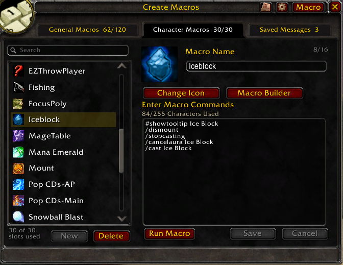
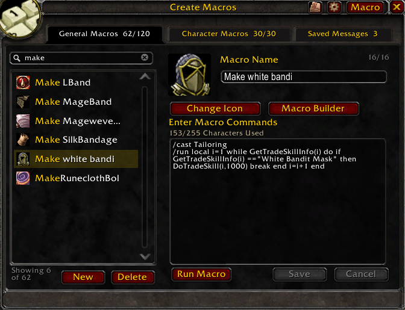
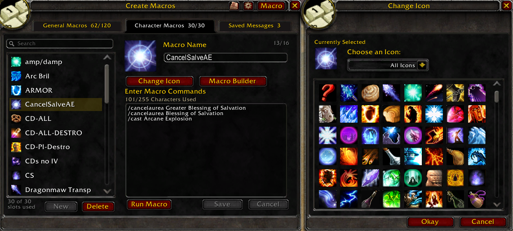
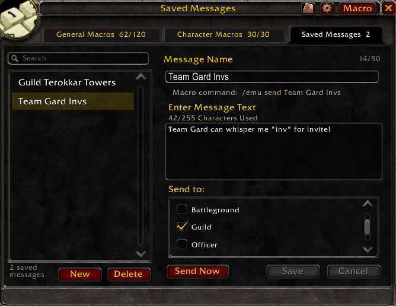
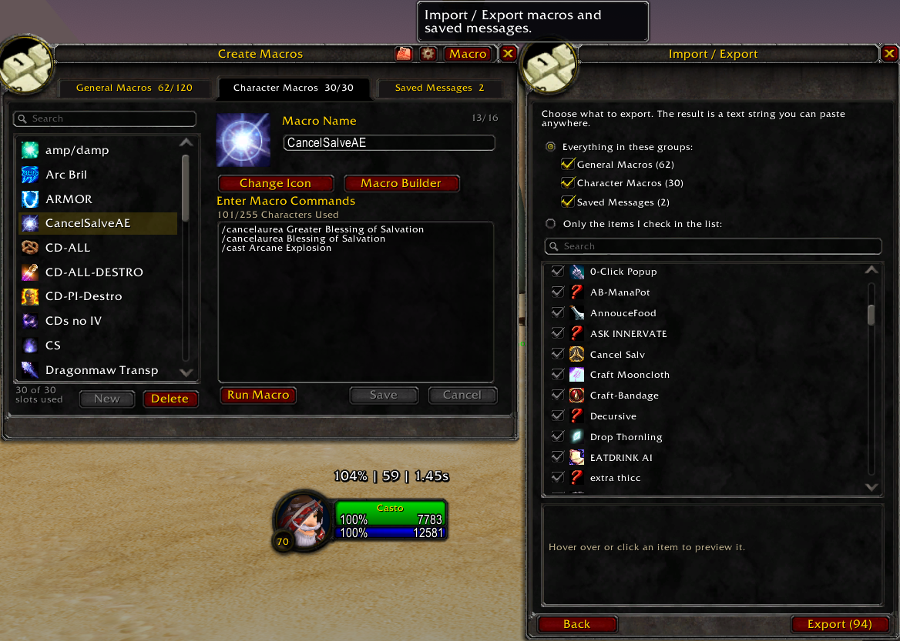

# Extended Macro UI

A replacement macro window for World of Warcraft Classic (Classic Era /
Anniversary) with a tabbed, two-pane layout: a searchable A–Z list of macros on
the left and a rich editor on the right.

Open it with `/emu`.

## Features

### General & Character macros

A searchable A–Z list with a rich editor, an icon picker, drag-to-action-bar,
and per-row duplicate. The search box fuzzy-matches by name, so `make` narrows
the list instantly and the footer shows how many of your macros match.

### Macro Builder

A guided side panel that composes `/cast`, `/use`, `/equip` or `/emu send`
commands — with targeting and modifier conditionals — and inserts them into the
macro being edited, with a live preview of the generated line.

![The Macro Builder panel docked to the right, composing an Equip Item command with a Mouse Button 2 modifier and a "/equip [btn:2]" preview](docs/screenshots/03-macro-builder.png)

### Change Name / Icon

A docked picker for renaming a macro and choosing its icon, filterable by All /
Spell / Item icons, with the name synced live to the editor.

### Saved Messages

Reusable chat messages that broadcast to multiple channels at once — outside the
macro system, so they don't consume macro slots. Call one from
`/emu send <name>`, with a global anti-spam interval.

### Import / Export

A wizard (header button next to the settings gear) that exports all or selected
General macros, Character macros and Saved Messages to a shareable text string,
and imports such a string with per-item selection, a preview, and an
overwrite-or-copy policy for name conflicts. The string is `!EMU:<version>!`
followed by Base64(Deflate(CBOR(payload))), built with the client's own
`C_EncodingUtil`; the payload records the exporting character, realm, timestamp
and addon version.

### Minimap button / data broker

A LibDataBroker launcher (shown by Titan Panel and other broker displays) plus
an optional LibDBIcon minimap button (on by default; toggle it in the EMU
settings). Left-click opens the window; right-click opens a menu that sends a
Saved Message.

## Embedded libraries

`Libs/` holds unmodified copies of LibStub, CallbackHandler-1.0,
LibDataBroker-1.1 and LibDBIcon-1.0, loaded by the TOC. LibStub loads only the
newest copy across all installed addons, so these never conflict with other
addons' copies. See `/emu help` for the other sub-commands.

## Known issues

- **Run Macro button layers above other `DIALOG`-strata windows.** The editor's
  "Run Macro" button is a secure button parented to `UIParent` and placed at
  `DIALOG` strata so it stays visible above Blizzard's full-screen
  `TimerTracker` frame (which is also `DIALOG`). As a side effect it can render
  on top of other `DIALOG`-strata addon windows (e.g. TradeSkillMaster) even
  when they're focused over the macro window. This is a known edge case we may
  revisit; it does not affect functionality.
